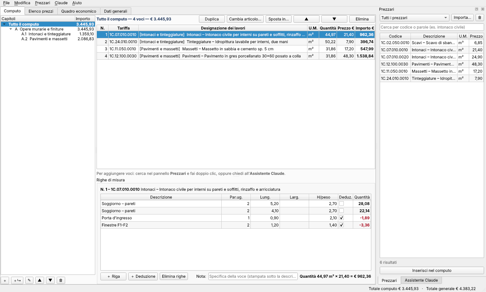

# CRN Computo

Programma per Windows per il **computo metrico estimativo**, con assistente **Claude** integrato.
Scritto in Python con Qt (PySide6), come CRN PDF Studio.



## Funzioni

**Computo**
- Capitoli e sottocapitoli (WBS) con totali e incidenze
- Voci numerate in ordine progressivo, collegate all'elenco prezzi del progetto
- Righe di misura in stile libretto: *parti uguali × lunghezza × larghezza × altezza/peso*
- Ogni campo accetta espressioni con la virgola decimale: `3,20+0,15`, `2*(4,5+3)`, `12,5/2`
- Deduzioni (vani porta e finestra, vuoti) con segno negativo
- Le voci senza misure o con formule errate sono evidenziate in rosso
- Duplica, sposta, cambia articolo, nota della voce
- Annulla e ripeti illimitati (Ctrl+Z / Ctrl+Y)

**Prezzari**
- Importazione dei prezzari regionali da **Excel (.xlsx)**, **CSV** e **XML SIX**
- Le colonne si riconoscono dalle intestazioni (Codice/Tariffa, Descrizione, U.M., Prezzo,
  Manodopera); le descrizioni dei gruppi («Scavi», «Intonaci»…) si uniscono a quella della voce
- Libreria locale dei prezzari, ricerca per codice o parole senza badare ad accenti e plurali
- Doppio clic su un risultato per inserirlo nel computo
- Nuovi prezzi (NP) per lavorazioni non presenti nel prezzario

**Quadro economico**
- Lavori soggetti a ribasso e oneri della sicurezza (da voci marcate, in percentuale o a corpo)
- Ribasso d'asta e importo contrattuale
- IVA sui lavori e somme a disposizione (importo o percentuale, con la loro IVA)
- Stima dell'incidenza della manodopera

**Stampe**
- Computo metrico estimativo in PDF, con o senza righe di misura, con riepilogo per capitoli
- Elenco prezzi unitari con il prezzo in lettere («euro dodici/34»)
- Quadro economico in PDF
- Tutto in Excel (fogli Computo, Elenco prezzi, Quadro economico)

**Assistente Claude** (pannello a destra, Ctrl+K)
- Imposta la struttura dei capitoli, cerca le voci nei prezzari e le inserisce con le misure
- Ricava le quantità da **piante e sezioni allegate** (PDF o immagini, pulsante 📎 Allega)
- Controlla il computo: voci senza misure, unità incoerenti, prezzi anomali, lavorazioni mancanti
- Imposta il quadro economico e scrive descrizioni dei lavori
- Non inventa codici o prezzi: se una voce manca nel prezzario propone un nuovo prezzo e chiede conferma
- Tutte le modifiche di una risposta si annullano insieme con un solo Ctrl+Z
- Serve una chiave API di Anthropic (pulsante ⚙ nel pannello); se è già inserita in CRN PDF Studio
  viene usata anche qui

## File

- Progetti: `.crcm` (JSON leggibile, salvato in modo sicuro con un file temporaneo)
- Prezzari importati: cartella dati dell'utente (`%APPDATA%\CRN\CRN Computo\prezzari`),
  apribile da *Prezzari → Apri cartella dei prezzari*

## Avvio e compilazione

```
pip install -r requirements.txt
python main.py [progetto.crcm]
```

Eseguibile Windows: `build_windows.bat` (crea `dist\CRNComputo\CRNComputo.exe`). Lo stesso avviene in
GitHub Actions a ogni modifica della cartella `computo/` (pacchetto portabile tra gli artifact).

Test: `python -m pytest -q tests` (con `QT_QPA_PLATFORM=offscreen` su un server senza schermo).
