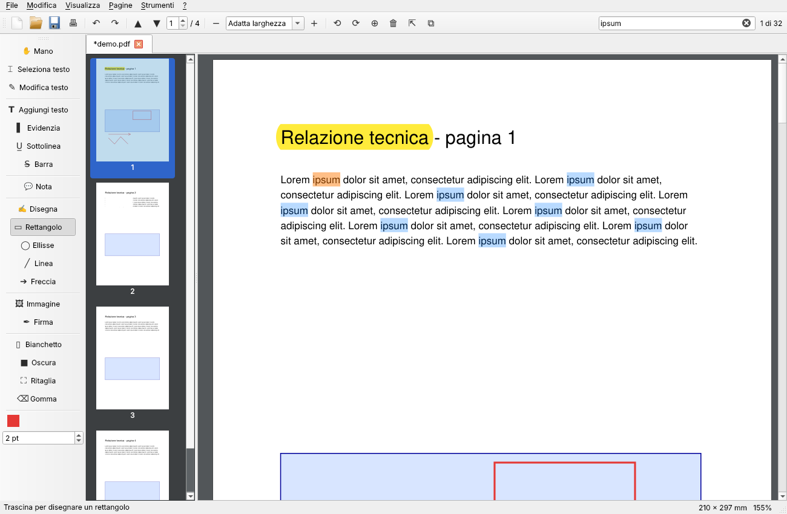

# PDF Studio

Lettore ed editor PDF per Windows, in stile Adobe Acrobat. Scritto in Python con
[PyMuPDF](https://pymupdf.readthedocs.io/) (motore MuPDF) e Qt (PySide6).



## Funzioni

**Lettura**
- Visualizzazione a scorrimento continuo, zoom (Ctrl+rotellina, adatta larghezza/pagina)
- Miniature delle pagine, più documenti aperti in schede
- Ricerca nel testo (Ctrl+F, Invio = successivo, Maiusc+Invio = precedente)
- Apre anche immagini, XPS, EPUB (convertiti in PDF); trascinamento dei file sulla finestra
- Documenti protetti da password, stampa, file recenti

**Modifica e commenti** (barra a sinistra)
- Modifica del testo esistente (clic sulla riga → nuovo testo, dimensione, colore)
- Aggiungi testo (nel contenuto della pagina o come commento modificabile)
- Evidenzia, sottolinea, barra il testo; note adesive
- Disegno a mano libera, rettangoli, ellissi, linee, frecce (colore e spessore regolabili)
- Inserimento immagini e **firma** (disegnata, digitata o da immagine)
- Bianchetto, **oscuramento definitivo** (redazione) del contenuto, ritaglio pagina
- Gomma per eliminare commenti/disegni; doppio clic con la mano per modificare un commento
- Compilazione dei moduli PDF (clic sul campo con lo strumento Mano)
- Annulla/Ripeti (Ctrl+Z / Ctrl+Y)

**Pagine**
- Ruota, elimina, duplica, inserisci pagina vuota o pagine da altro PDF/immagini
- Riordina trascinando le miniature (selezione multipla con Ctrl/Maiusc)
- Estrai pagine, dividi il documento, unisci più file

**Creazione ed esportazione**
- Nuovo PDF vuoto (A4, A3, A5, Lettera…), PDF da immagini, unione di file
- Filigrana, numeri di pagina, proprietà/metadati
- Protezione con password (AES 256 bit) e rimozione protezione
- Riduzione della dimensione del file
- Esporta come immagini PNG/JPG, testo, Word (.docx)
- OCR per documenti scansionati (richiede [Tesseract](https://github.com/UB-Mannheim/tesseract/wiki))

## Avvio dai sorgenti

```bat
cd pdf_studio
py -3 -m pip install -r requirements.txt
py -3 main.py [file.pdf]
```

## Creare l'eseguibile per Windows

1. Installare Python 3.10+ per Windows.
2. Eseguire `build_windows.bat` → crea `dist\PDFStudio\PDFStudio.exe` (cartella portabile).
3. (Facoltativo) Aprire `installer.iss` con [Inno Setup 6](https://jrsoftware.org/isinfo.php) e compilare:
   si ottiene `dist\PDFStudio-Setup-1.0.0.exe`, con collegamenti nel menu Start e
   associazione facoltativa dei file `.pdf`.

In alternativa, il workflow GitHub Actions `.github/workflows/pdf-studio-windows.yml` compila
automaticamente eseguibile e installer su Windows a ogni push: si scaricano dalla sezione
*Actions → ultima esecuzione → Artifacts*.

## Test

```bash
python -m pytest -q tests
```

## Struttura

| File | Contenuto |
|---|---|
| `pdfstudio/document.py` | Tutte le operazioni sul PDF (senza interfaccia), annulla/ripeti |
| `pdfstudio/viewer.py` | Visualizzatore pagine e gestione degli strumenti col mouse |
| `pdfstudio/thumbnails.py` | Pannello miniature con riordino |
| `pdfstudio/dialogs.py` | Finestre di dialogo (testo, firma, filigrana, password…) |
| `pdfstudio/mainwindow.py` | Finestra principale, menu e barre degli strumenti |

## Licenza

PyMuPDF/MuPDF sono distribuiti con licenza **AGPL-3.0**: va bene per uso personale e
interno, ma per distribuire o vendere il programma a terzi come software chiuso serve una
licenza commerciale di Artifex (oppure rilasciare il codice sotto AGPL).
